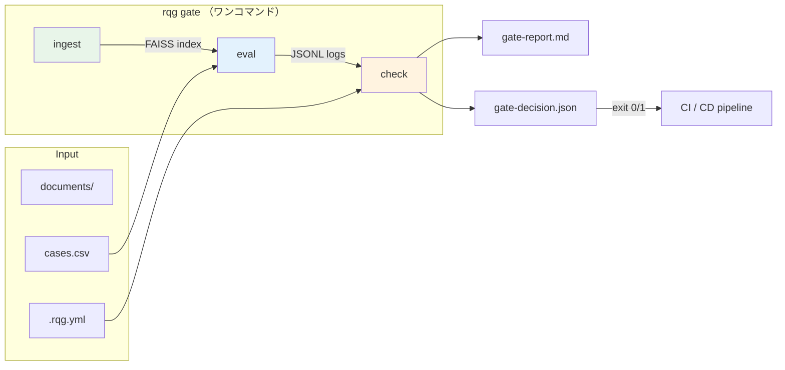
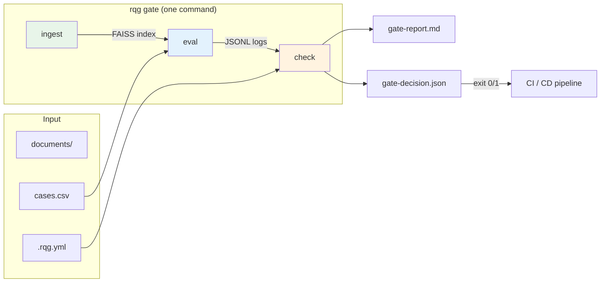

# RAG Quality Gate

[日本語](#日本語--japanese) | [English](#english)

## 日本語 / Japanese

RAG/Agent の品質を、毎回同じやり方で検証してリリース判定までつなぐための実運用向け品質ゲート基盤です。

この製品は AI を賢くするものではなく、AI を安全に更新・運用するための品質管理レイヤです。

最初の市場導線として、社内文書（規程・FAQ・手順書・ナレッジ記事・社内 Wiki）向け縦パックを同梱しています。
現在は HR プロファイルと Wiki/FAQ プロファイルの 2 つを見本として提供します。

## アーキテクチャ



**データフロー**: documents → FAISS ingest → eval（キーワード + retrieval + reference 評価）→ check（閾値判定）→ pass/fail 出力

## この製品が解決すること

| 課題 | RQG の解決策 |
|------|-------------|
| 変更のたびに品質確認が属人化する | `rqg gate` で定型化。毎回同じ基準 |
| 重大ケースの取りこぼし | S1/S2 の severity 分離。S1 は 100% pass 必須 |
| fail 時にどこから直すべきか不明 | gate-report.md に failure category + next action |
| PR の品質判定が曖昧 | CI exit code 0/1 で機械的に判定 |

## なぜ RQG?（競合との位置づけ）

| | RQG | Ragas / DeepEval | LangSmith | Braintrust |
|---|---|---|---|---|
| **主目的** | 運用チーム向け回帰ゲート | LLM 評価フレームワーク | LLM observability | LLM eval + logging |
| **誰が使う** | QA・運用・ドメインオーナー | ML エンジニア | 開発者 | 開発者 |
| **CI gate** | ネイティブ対応 (exit 0/1) | 自分で組む | webhook/API | 自分で組む |
| **ケース資産管理** | cases.csv + merge/validate | なし | なし | Datasets |
| **severity 運用** | S1/S2 分離・閾値別 | なし | なし | なし |
| **API キー不要** | `--mock` で即体験 | 必要 | 必要 | 必要 |
| **導入コスト** | `pip install` + 1 コマンド | SDK 統合 | SaaS 登録 | SaaS 登録 |

**RQG は「評価の精度を極める」ツールではなく、「品質チェックを運用に定着させる」ためのゲート基盤です。**

## CLI コマンドマップ

```
rqg gate     ← 最初はこれだけ（eval + check のワンコマンド）
 ├── eval        回帰テスト実行
 ├── check       閾値判定 + レポート出力
 └── ingest      文書の FAISS インデックス作成

rqg validate-connection  外部RAG endpoint の接続/契約検証
rqg history             gate decision の時系列確認
rqg gen-cases    ケース草案を文書から自動生成
rqg merge-cases  生成ケースを cases.csv に安全マージ
rqg validate-cases  cases.csv のバリデーション
rqg impact       文書変更の影響ケース特定

rqg init-pack    テンプレートから pack を初期化
rqg init-snapshot / create-sample-case / create-sample-gate  scaffold 用
rqg migrate-cases  レガシー参照の移行
```

GitHub Actions 向けの導入テンプレートは `templates/github/` に同梱しています。

**日常で使うのは `gate` (+ `gen-cases` / `merge-cases`) の 2-3 コマンドです。**

## 評価ツールとの違い

Ragas・DeepEval・LangSmith・Braintrust などの LLM 評価ツールは「スコアを出す」ところで完結します。
RQG は評価の先にある **運用サイクル全体** をカバーします。

| 能力 | 一般的な評価ツール | RQG |
|---|---|---|
| 回答品質スコアリング | ✅ | ✅ |
| 文書変更 → 影響ケース特定 (impact analysis) | — | ✅ |
| pass/warn/fail リリース判定 (release gate) | — | ✅ CI 統合済み |
| fail → 原因分類 → 改善アクション (next actions) | — | ✅ |
| 週次レビューと指標蓄積 (weekly review) | — | ✅ |
| severity 別運用 S1/S2 | — | ✅ |
| ドメイン縦パック (pack 運用) | — | ✅ |
| ケース自動追従 (migrate-cases) | — | ✅ |

一言で言えば、**eval で終わらず、gate → review → fix → re-eval のループを回す基盤** です。

## 縦パック（社内文書向けプロファイル）

このリポジトリでは、社内文書を知識源とする業務支援 AI 向けに次の 2 プロファイルを同梱しています。

- packs/hr: 人事・就業規程中心の HR プロファイル
- packs/wiki: 社内 FAQ/ナレッジベース中心の Wiki/FAQ プロファイル

- 文書更新時に impacted cases を特定する
- 重大ケース（S1）を優先して eval/check する
- pass/warn/fail で本番反映の可否を判断する
- fail を review と改善アクションに接続する

中身は水平な品質ゲート基盤のまま維持し、縦パックは導入しやすく価値を伝えるための入口として提供します。

## 使い方（3パターン）

### パターン A: ワンコマンド体験（30秒）

```bash
pip install -e ".[dev]"
rqg gate packs/hr/cases.csv --docs packs/hr/documents --mock --index-dir index --log-dir runs/quality --config .rqg.yml
cat runs/quality/gate-report.md
```

### パターン B: デモで全機能を体験（5-10分）

```bash
python -m rqg.demo.onboarding_quickstart
# Wiki/FAQ profile:
python -m rqg.demo.onboarding_quickstart --profile wiki
```

出力: `demo_runs/onboarding_quickstart/<run-id>/` 配下に summary.json, review.md, impact_review.md

### パターン C: 段階的に導入

```bash
# 1. テンプレート配置
rqg init-pack packs/my_pack

# 2. eval + check をワンコマンドで
rqg gate packs/my_pack/cases.csv \
  --docs packs/my_pack/documents \
  --mock --index-dir index --log-dir runs/quality \
  --config .rqg.yml

# 3. 出力を確認
cat runs/quality/gate-report.md
cat runs/quality/gate-decision.json

# 4. ケースを育てる（任意）
rqg gen-cases --snapshot runs/snapshots/latest.json --output runs/casegen/cases.json --review-output runs/casegen/review.csv
rqg merge-cases --cases packs/my_pack/cases.csv --review runs/casegen/review.csv --in-place
```

## ドキュメント案内

README は製品概要と導入に絞っています。技術仕様・運用設計の詳細は docs を参照してください。

- docs ポータル（日英）: docs/README.md

導入とデモ:

- docs/demo/onboarding-quickstart.md
- docs/demo/fail-fix-cycle.md
- docs/demo/impact-cycle.md
- packs/hr/README.md

技術設計:

- docs/adr/0001-model-boundaries.md
- docs/adr/0002-product-charter-and-development-priorities.md

運用設計（Phase2 / Phase2.5）:

- docs/ops/archive/phase2-migration-playbook.md
- docs/ops/archive/phase2-kickoff-board.md
- docs/ops/operations/phase2-weekly-metrics-register.md
- docs/ops/archive/phase2-5-hardening-plan.md
- docs/ops/operations/phase2-5-weekly-metrics-register.md
- docs/ops/operations/phase2-5-investigate-response-flow.md
- docs/ops/operations/phase2-5-case-quality-weekly-review.md
- docs/ops/operations/phase3-internal-docs-vertical-pack.md

## ライセンス

MIT

---

## English

RAG Quality Gate is a production-oriented quality-gate foundation that lets teams validate RAG/Agent quality in a repeatable way and connect results directly to release decisions.

This product does not make models smarter. It provides a quality-management layer for safe updates and operations.

As the first market-facing entry point, this repository includes internal-documents vertical packs (policy docs, FAQs, SOPs, knowledge pages, internal wiki style content).
There are two bundled profiles: HR and Wiki/FAQ.

## Architecture



**Data flow**: documents → FAISS ingest → eval (keyword + retrieval + reference scoring) → check (threshold decision) → pass/fail output

## Problems It Solves

| Problem | RQG Solution |
|---------|-------------|
| Quality checks become inconsistent | `rqg gate` standardizes them — same criteria every time |
| Critical cases are missed | S1/S2 severity separation; S1 requires 100% pass |
| Unclear what to fix on failure | gate-report.md shows failure category + next action |
| Ambiguous PR quality criteria | CI exit code 0/1 for machine-readable decisions |

## Why RQG? (Competitive Positioning)

| | RQG | Ragas / DeepEval | LangSmith | Braintrust |
|---|---|---|---|---|
| **Primary purpose** | Regression gate for ops teams | LLM evaluation framework | LLM observability | LLM eval + logging |
| **Target user** | QA, ops, domain owners | ML engineers | Developers | Developers |
| **CI gate** | Native (exit 0/1) | DIY | Webhook/API | DIY |
| **Case asset management** | cases.csv + merge/validate | None | None | Datasets |
| **Severity-based ops** | S1/S2 split with separate thresholds | None | None | None |
| **No API key needed** | `--mock` mode for instant demo | Required | Required | Required |
| **Setup cost** | `pip install` + 1 command | SDK integration | SaaS signup | SaaS signup |

**RQG is not about maximizing evaluation accuracy — it's about making quality checks stick in daily operations.**

## CLI Command Map

```
rqg gate     ← start here (eval + check in one command)
 ├── eval        run regression tests
 ├── check       threshold decision + report
 └── ingest      build FAISS index from documents

rqg gen-cases    auto-generate draft cases from documents
rqg merge-cases  safely merge generated cases into cases.csv
rqg validate-cases  validate cases.csv rows
rqg impact       identify impacted cases from document changes

rqg init-pack    scaffold a pack from bundled templates
rqg init-snapshot / create-sample-case / create-sample-gate  scaffolding
rqg migrate-cases  migrate legacy evidence references
```

**Day-to-day you only need `gate` (+ `gen-cases` / `merge-cases`) — 2-3 commands.**

## How RQG Differs From Eval Tools

Tools like Ragas, DeepEval, LangSmith, and Braintrust stop at scoring.
RQG covers the **full operational cycle** beyond evaluation.

| Capability | Typical eval tools | RQG |
|---|---|---|
| Answer quality scoring | ✅ | ✅ |
| Document change → impacted case detection (impact analysis) | — | ✅ |
| pass/warn/fail release decision (release gate) | — | ✅ CI-integrated |
| fail → root cause → corrective action (next actions) | — | ✅ |
| Weekly review and metrics accumulation (weekly review) | — | ✅ |
| Severity-based operations S1/S2 | — | ✅ |
| Domain vertical packs (pack operations) | — | ✅ |
| Automatic case migration (migrate-cases) | — | ✅ |

In short: **RQG does not stop at eval — it drives the gate → review → fix → re-eval loop.**

## Vertical Pack Profiles (Internal Documents)

This repository includes two internal-documents profiles for assistant AI.

- packs/hr: HR policy/procedure profile
- packs/wiki: internal FAQ/wiki operations profile

- Identify impacted cases when documents change
- Protect critical cases (S1) first during eval/check
- Decide production rollout with pass/warn/fail
- Connect failures to review and corrective actions

The product core remains horizontal. The vertical pack is an adoption and value-communication entry point.

## Usage (3 Patterns)

### Pattern A: One-Command Experience (30 seconds)

```bash
pip install -e ".[dev]"
rqg gate packs/hr/cases.csv --docs packs/hr/documents --mock --index-dir index --log-dir runs/quality --config .rqg.yml
cat runs/quality/gate-report.md
```

### Pattern B: Full Demo (5-10 minutes)

```bash
python -m rqg.demo.onboarding_quickstart
# Wiki/FAQ profile:
python -m rqg.demo.onboarding_quickstart --profile wiki
```

Outputs: `demo_runs/onboarding_quickstart/<run-id>/` with summary.json, review.md, impact_review.md

### Pattern C: Gradual Adoption

```bash
# 1. Scaffold a pack
rqg init-pack packs/my_pack

# 2. Run eval + check in one command
rqg gate packs/my_pack/cases.csv \
  --docs packs/my_pack/documents \
  --mock --index-dir index --log-dir runs/quality \
  --config .rqg.yml

# 3. Review outputs
cat runs/quality/gate-report.md
cat runs/quality/gate-decision.json

# 4. Grow your cases (optional)
rqg gen-cases --snapshot runs/snapshots/latest.json --output runs/casegen/cases.json --review-output runs/casegen/review.csv
rqg merge-cases --cases packs/my_pack/cases.csv --review runs/casegen/review.csv --in-place
```

## Documentation

This README focuses on product overview and onboarding. See docs for detailed technical and operational guidance.

- docs portal (JP/EN): docs/README.md

Getting started and demos:

- docs/demo/onboarding-quickstart.md
- docs/demo/fail-fix-cycle.md
- docs/demo/impact-cycle.md
- packs/hr/README.md

Architecture:

- docs/adr/0001-model-boundaries.md
- docs/adr/0002-product-charter-and-development-priorities.md

Operations (Phase2 / Phase2.5):

- docs/ops/archive/phase2-migration-playbook.md
- docs/ops/archive/phase2-kickoff-board.md
- docs/ops/operations/phase2-weekly-metrics-register.md
- docs/ops/archive/phase2-5-hardening-plan.md
- docs/ops/operations/phase2-5-weekly-metrics-register.md
- docs/ops/operations/phase2-5-investigate-response-flow.md
- docs/ops/operations/phase2-5-case-quality-weekly-review.md
- docs/ops/operations/phase3-internal-docs-vertical-pack.md

## License

MIT
