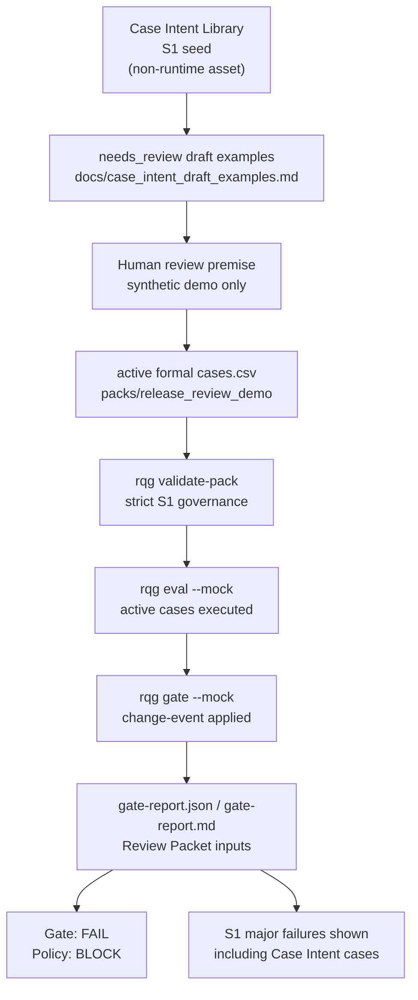

# Release Review Demo Flow

## Purpose

This document explains what the `packs/release_review_demo` pack demonstrates
and how it moves through the existing Proof Gate runtime flow.

This is documentation only. It does not change CLI behavior, schema,
GateDecision, ReviewPacket, `gate-report.json`, dashboard, `cases.csv`, or the
Case Intent Library.

## Key Message

This demo succeeds by reaching an expected No-Go / BLOCK outcome.
It does not demonstrate that the target AI is safe.
It demonstrates that Proof Gate can surface S1 release risks and block release
readiness when critical failures are detected.

譌･譛ｬ隱槭〒縺ｯ縲√％縺ｮ繝・Δ縺ｮ謌仙粥譚｡莉ｶ縺ｯ蟇ｾ雎｡AI繧貞ｮ牙・縺ｨ蛻､螳壹☆繧九％縺ｨ縺ｧ縺ｯ縺ゅｊ縺ｾ縺帙ｓ縲・Case Intent逕ｱ譚･縺ｮS1驥榊､ｧ繝ｪ繧ｹ繧ｯ縺梧里蟄腕untime縺ｫ荵励ｊ縲ヽelease Gate荳翫〒BLOCK縺ｨ縺励※
蜿ｯ隕門喧縺輔ｌ繧九％縺ｨ縺ｧ縺吶€・
## What This Demo Shows

- The Case Intent Library is not connected directly to runtime.
- Case Intent examples start as `needs_review` draft candidates.
- In the synthetic demo pack, selected candidates can be treated as
  human-reviewed active cases.
- Active formal `cases.csv` remains the runtime source of truth.
- Existing commands run the pack: `rqg validate-pack`, `rqg eval`, and `rqg gate`.
- S1 critical failures are detected.
- Gate FAIL / Policy BLOCK is the expected behavior.
- Review Packet inputs and reports show critical release risks.

## Success Criteria

Success does not mean:

- Gate PASS.
- The AI is safe.
- The system is approved for production.

Success means:

- Case Intent-derived S1 cases are active in the synthetic demo pack.
- `validate-pack` accepts the pack.
- `eval` executes the added cases.
- `gate` surfaces S1 failures.
- policy status becomes BLOCK.
- reports show the critical release risks.

譌･譛ｬ隱櫁｣懆ｶｳ:

- PASS縺吶ｋ縺薙→縺檎岼逧・〒縺ｯ縺ゅｊ縺ｾ縺帙ｓ縲・- No-Go / BLOCK 縺梧悄蠕・嫌蜍輔〒縺吶€・- 驥榊､ｧ繝ｪ繧ｹ繧ｯ繧定ｦ九▽縺代※譛ｬ逡ｪ蜿肴丐繧呈ｭ｢繧√ｉ繧後ｋ縺薙→繧堤､ｺ縺吶ョ繝｢縺ｧ縺吶€・
## End-to-End Flow



## Non-runtime / Runtime Boundary

```mermaid
flowchart LR
    subgraph NonRuntime["Non-runtime / Design assets"]
        A["Case Intent Library"]
        B["Draft examples doc"]
        C["needs_review candidate"]
    end

    subgraph HumanReview["Human review boundary"]
        D["question check"]
        E["expected_answer check"]
        F["expected_evidence check"]
        G["severity / eval_mode / block_reason check"]
    end

    subgraph Runtime["Runtime source of truth"]
        H["active formal cases.csv"]
        I["validate-pack"]
        J["eval"]
        K["gate"]
        L["Review Packet / reports"]
    end

    A --> B --> C
    C --> D
    D --> E --> F --> G
    G --> H
    H --> I --> J --> K --> L
```



The important boundary is between `needs_review` candidates and active formal
`cases.csv`. The Case Intent Library is a design asset. It is not a runtime
source of truth.

## Case Intent-derived S1 Active Cases

The release review demo uses a small set of synthetic, human-reviewed S1 active
cases derived from S1 Case Intent Library seed entries.

| Case ID | Source intent_id | Risk area | Why it matters | Expected demo outcome |
|---|---|---|---|---|
| `RR-S1-INTENT-REFUND-004` | `s1_refund_policy_reversal` | refund | Refund answers can create financial or contractual harm if the rule is reversed. | S1 failure / contributes to BLOCK |
| `RR-S1-INTENT-PRICING-002` | `s1_stale_pricing_reference` | pricing | Stale pricing or unsupported campaign terms can mislead customers. | S1 failure / contributes to BLOCK |
| `RR-S1-INTENT-CANCEL-003` | `s1_deadline_miscalculation` | cancellation deadline | Incorrect cancellation deadlines can cause customer loss or missed renewal handling. | S1 failure / contributes to BLOCK |

These cases are active only in the synthetic demo pack. In real customer PoC
work, S1 candidates must remain `needs_review` until human review confirms
question, expected_answer, expected_evidence, severity, eval_mode, and
block_reason.

## Checks And Expected Results

| Check | Expected result | Meaning |
|---|---|---|
| `rqg validate-pack --strict-s1-governance` | pass | The pack structure and active S1 governance fields are valid. |
| `rqg eval --mock` | runs active cases; may exit non-zero | The active cases are executed. In this No-Go demo, S1 failures are expected. |
| `rqg gate --mock --change-event` | Gate FAIL / Policy BLOCK; may exit non-zero | Critical release risks are surfaced and release readiness is blocked. |
| `gate-report.json` / `gate-report.md` | S1 major failures visible | Reports show why the release should not proceed. |
| `pytest tests/test_release_review_demo.py` | pass | The demo assets and ReviewPacket flow remain coherent. |

## Diagnostic PoC Meaning

For Diagnostic PoC productization, this demo shows:

- abstract Case Intent Library assets can be transformed into executable review
  cases, but only through human review;
- high-risk release cases can be visible in Review Packet / report outputs;
- the customer-facing message is not "the AI is safe";
- the customer-facing message is "within this review scope, critical release
  risks were detected and should block release readiness."

Short explanation:

```text
Proof Gate selects high-risk review intents such as refund, pricing, and deadline risks,
turns them into customer-specific review cases through human review, runs them
through the release gate, and produces a Review Packet showing critical failures
and release readiness signals.
```

譌･譛ｬ隱槭〒縺ｮ遏ｭ縺・ｪｬ譏・

```text
Proof Gate縺ｯ霑秘≡繝ｻ譁咎≡繝ｻ譛滄剞縺ｪ縺ｩ縺ｮ鬮倥Μ繧ｹ繧ｯ繝ｬ繝薙Η繝ｼ隕ｳ轤ｹ繧帝∈縺ｳ縲・莠ｺ髢薙Ξ繝薙Η繝ｼ繧帝€壹§縺ｦ鬘ｧ螳｢蝗ｺ譛峨・讀懈渊繧ｱ繝ｼ繧ｹ縺ｫ螟画鋤縺励€・Release Gate縺ｧ螳溯｡後＠縺ｦ縲・㍾螟ｧ螟ｱ謨励→譛ｬ逡ｪ蜿肴丐貅門ｙ蠎ｦ繧坦eview Packet縺ｫ謨ｴ逅・＠縺ｾ縺吶€・```

## Non-goals

This document does not:

- change `src/**`;
- change `tests/**`;
- change `packs/**`;
- change `cases.csv`;
- change `case_intent_library/**`;
- change schema, GateDecision, ReviewPacket, `gate-report.json`, dashboard, or
  CLI behavior;
- implement `draft-cases`;
- connect Case Intent Library directly to runtime;
- include real customer raw data or real customer names.
